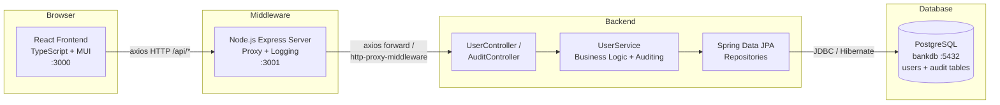
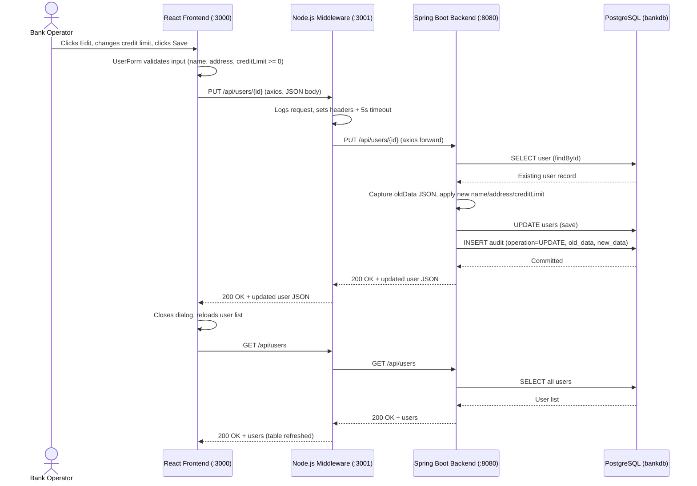
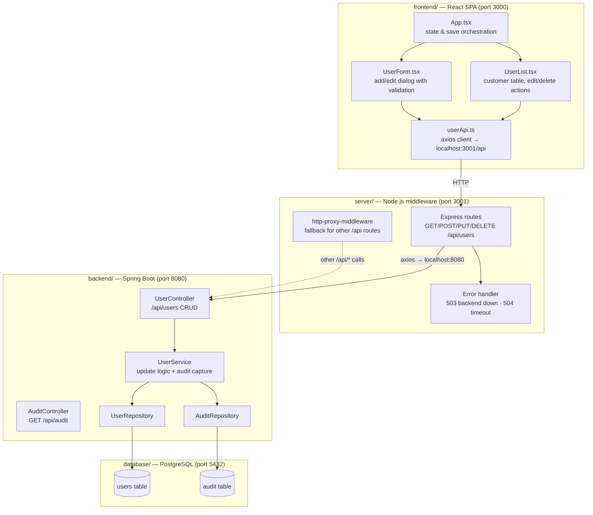
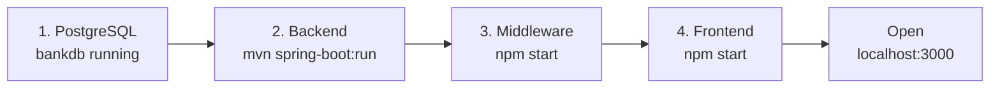
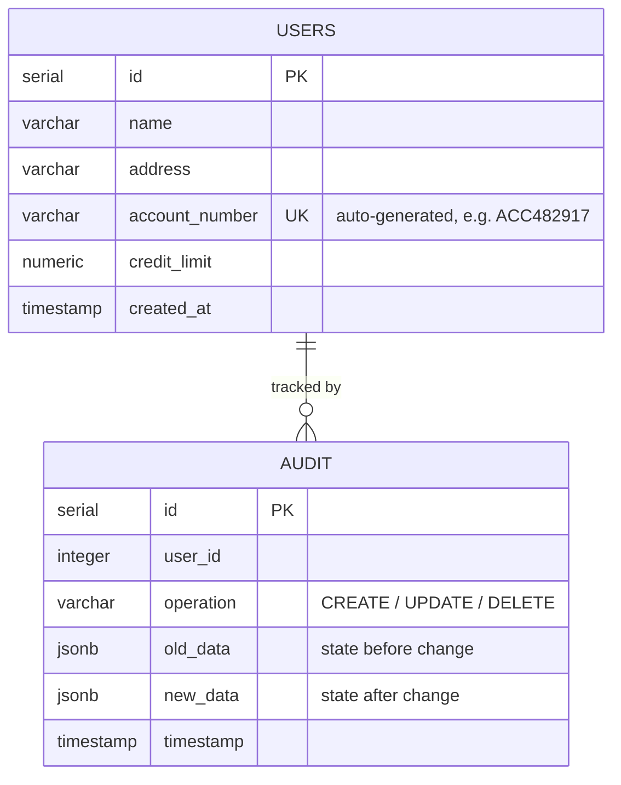

# Full Stack Banking Application

A full-stack banking application for managing customer information and credit limits. Bank staff can view all customers, add new customers, update customer details (name, address, credit limit), and remove customers — with every change automatically recorded in an audit trail for compliance and traceability.

## Project Description

The core use case of this application is **updating customer information and their credit limit**:

1. A bank operator opens the React web UI, which displays a table of all customers with their name, account number, address, and current credit limit.
2. The operator clicks the **Edit** icon on a customer row, which opens a pre-filled form dialog.
3. The operator modifies the customer's name, address, or **credit limit** and clicks **Save**.
4. The request travels through the Node.js middleware server to the Spring Boot backend, which validates and persists the change to PostgreSQL.
5. Before saving, the backend captures the customer's previous state; after saving, it writes an **audit record** containing the operation type (`UPDATE`), the old data, and the new data as JSON — so every credit limit change is fully traceable.
6. The UI refreshes the customer list to reflect the updated values.

The same flow supports creating new customers (account numbers are auto-generated, e.g. `ACC482917`) and deleting customers, with `CREATE` and `DELETE` audit entries written respectively.

## High-Level Architecture



### Request Flow — Updating a Customer's Credit Limit



## Technical Stack

| Layer | Technology | Details |
|---|---|---|
| **Frontend** | React 18 + TypeScript | Material-UI (MUI) v5 components, axios for HTTP, react-router-dom |
| **Middleware Server** | Node.js + Express 5 | Request forwarding via axios, fallback proxy via http-proxy-middleware, CORS enabled, detailed logging & error mapping |
| **Backend** | Spring Boot 3.2.5 (Java 17) | Spring Web (REST), Spring Data JPA (Hibernate), springdoc-openapi (Swagger UI) |
| **Database** | PostgreSQL | `bankdb` database, `users` and `audit` tables, JSONB columns for audit payloads |
| **Build Tools** | Maven (backend), npm (frontend & server) | spring-boot-maven-plugin, react-scripts |

## How the Components Interact



**Interaction summary:**

- **Frontend → Middleware:** The React app never calls Spring Boot directly. All API calls go through `userApi.ts` to `http://localhost:3001/api/*`, keeping the backend URL decoupled from the UI.
- **Middleware → Backend:** The Express server forwards each request to `http://localhost:8080` using axios with a 5-second timeout, logs every request/response, and translates failures into meaningful HTTP errors (`503` when the backend is down, `504` on timeout). Any `/api/*` route not explicitly handled falls through to `http-proxy-middleware`.
- **Backend → Database:** Spring Data JPA repositories map the `User` and `Audit` entities to PostgreSQL tables. On startup, `schema.sql` creates the tables (if missing) and `data.sql` seeds three sample customers.
- **Auditing:** `UserService` serializes the old and new user state to JSON and writes an `audit` row on every `CREATE`, `UPDATE`, and `DELETE`. Audit history is exposed read-only via `GET /api/audit`.

## Project Structure

```text
banking-app-fullstack/
├── frontend/                  # React + TypeScript SPA (port 3000)
│   ├── src/
│   │   ├── App.tsx            # Root component — orchestrates list & form
│   │   ├── components/
│   │   │   ├── UserList.tsx   # Customer table with edit/delete actions
│   │   │   └── UserForm.tsx   # Add/edit dialog with field validation
│   │   ├── services/
│   │   │   └── userApi.ts     # Axios client → Node.js middleware (:3001)
│   │   └── types/
│   │       └── User.ts        # User type (name, address, accountNumber, creditLimit)
│   └── package.json
├── server/                    # Node.js Express middleware (port 3001)
│   ├── src/index.js           # Routes, forwarding, logging, error handling
│   ├── test-connection.js     # Script to verify backend connectivity
│   └── package.json
├── backend/                   # Spring Boot REST API (port 8080)
│   ├── src/main/java/com/example/banking/
│   │   ├── controller/        # UserController, AuditController
│   │   ├── service/           # UserService (business logic + auditing)
│   │   ├── repository/        # UserRepository, AuditRepository (JPA)
│   │   └── model/             # User, Audit entities
│   ├── src/main/resources/
│   │   ├── application.yaml   # Datasource & JPA config
│   │   ├── schema.sql         # Table definitions (auto-run on startup)
│   │   └── data.sql           # Seed data (auto-run on startup)
│   └── pom.xml
└── database/                  # Standalone schema reference
    └── schema.sql
```

## Prerequisites

- **Java 17+** and **Maven** (backend)
- **Node.js 16+** and **npm** (frontend & middleware server)
- **PostgreSQL 12+** running locally on port `5432`

## Database Setup

1. Start PostgreSQL and create the database:

   ```sql
   CREATE DATABASE bankdb;
   ```

2. The default credentials are `postgres` / `postgres`. If yours differ, update [application.yaml](backend/src/main/resources/application.yaml).

3. Tables and seed data are created automatically when the backend starts (via `schema.sql` and `data.sql`). To set up the schema manually instead, run:

   ```powershell
   psql -U postgres -d bankdb -f database/schema.sql
   ```

## Run Commands

Start the components in this order (each in its own terminal):

### 1. Backend — Spring Boot (port 8080)

```powershell
cd backend
mvn spring-boot:run
```

Or build a JAR and run it:

```powershell
cd backend
mvn clean package
java -jar target/backend-1.0-SNAPSHOT.jar
```

- REST API: http://localhost:8080/api/users
- Swagger UI (interactive API docs): http://localhost:8080/swagger-ui/index.html
- Audit log endpoint: http://localhost:8080/api/audit

### 2. Middleware — Node.js Express (port 3001)

```powershell
cd server
npm install
npm start
```

- Health check: http://localhost:3001/health
- To verify connectivity to the backend without starting the server:

  ```powershell
  node test-connection.js
  ```

### 3. Frontend — React (port 3000)

```powershell
cd frontend
npm install
npm start
```

The app opens automatically at http://localhost:3000.

### Quick Verification



Once all four are running, open http://localhost:3000 — the customer table should load the three seeded customers (John Doe, Jane Smith, Mike Johnson).

## API Endpoints

| Method | Endpoint | Description | Audited |
|---|---|---|---|
| GET | `/api/users` | List all customers | — |
| GET | `/api/users/{id}` | Get a single customer | — |
| POST | `/api/users` | Create a customer (account number auto-generated) | ✅ `CREATE` |
| PUT | `/api/users/{id}` | Update name, address, and credit limit | ✅ `UPDATE` |
| DELETE | `/api/users/{id}` | Delete a customer | ✅ `DELETE` |
| GET | `/api/audit` | View the full audit trail | — |

All endpoints are exposed by the Spring Boot backend on port `8080` and reachable through the Node.js middleware on port `3001`.

## Data Model



## Troubleshooting

| Symptom | Likely cause | Fix |
|---|---|---|
| UI shows "Could not connect to server" | Middleware not running | Start the Node.js server on port 3001 |
| Middleware returns `503 Backend service unavailable` | Spring Boot not running | Start the backend on port 8080 |
| Backend fails on startup with connection errors | PostgreSQL down or wrong credentials | Verify `bankdb` exists and credentials in `application.yaml` |
| Port already in use | Another process on 3000/3001/8080 | Stop the conflicting process or change the port |
